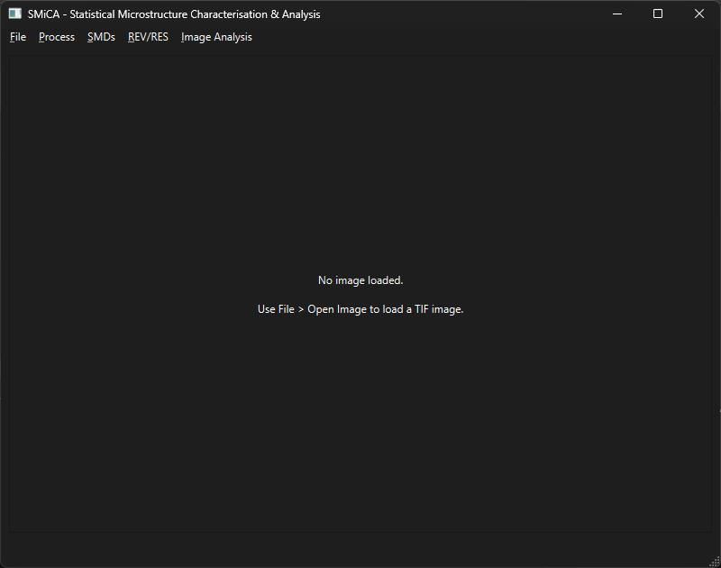
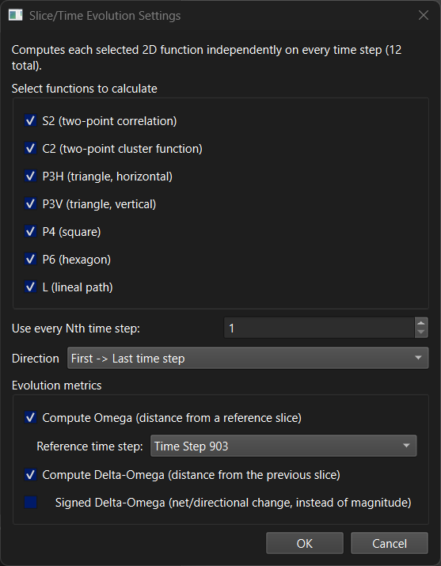
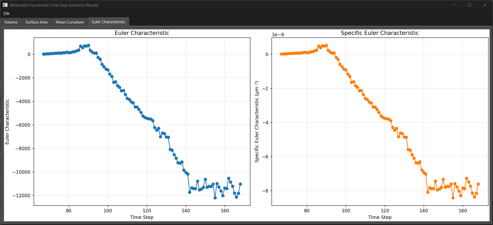
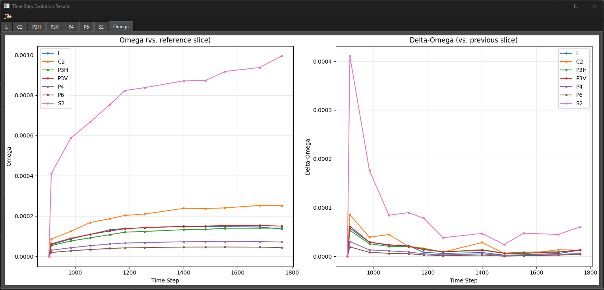

# SMiCA: Statistical Microstructure Characterisation & Analysis

A GUI application for analyzing microstructure images using correlation functions, Minkowski functionals, and other statistical/morphological descriptors, specifically designed for materials science and microstructure characterization.


## Features

### Image Loading & Large-Dataset Support

- **Single 2D/3D images**: open a binary TIF/TIFF file directly (multi-page TIFF = 3D volume).
- **3D volume from Z-slice folder**: assemble one 3D volume from a folder of 2D slice files.
- **Time series / 4D datasets from a folder**: each time step can be a single 2D slice or a full 3D volume, sorted by a number extracted from the filenames (with a range/select picker).
- **Low-memory streaming mode**: for datasets with many large 3D volumes (e.g. dozens of XCT volumes) that don't fit in RAM as one 4D array, only the file paths are kept and volumes are loaded, processed, and discarded one at a time - peak memory stays at "one volume's worth" regardless of how many time steps there are.
- **Interactive viewer**: slice/time sliders for 3D and 4D data, real-time pixel value on hover, coordinate tracking.
- **Long file paths**: images in deeply nested folders (paths over Windows' 260-character limit) load normally.

### Image Processing & Saving

- **Binarize**: pick the pixel value of the phase of interest; it becomes the foreground (1) and everything else the background (0).
- **Crop Center**: crops the largest box around the center of a cylindrical sample that lies completely inside the sample, removing the air around it. You choose the exterior (air) value, a cube or a square column, and an optional safety margin. Pores inside the sample with the same value as the air are kept, and for 3D volumes the box fits every slice, even when the sample shifts between slices or isn't perfectly round. The settings dialog doesn't block the viewer, so pixel values can still be checked by hovering over the image.
- **Save As**: save the image currently in the viewer, e.g. after binarizing or cropping:
  - *Image Sequence*: one TIFF file per slice in a chosen folder. Slices keep their original file names (or `<name>_0000.tif`, ... for a volume opened from one multi-page TIFF), so each slice keeps its original slice number, also after cropping.
  - *Single Image*: one TIFF file - a multi-page TIFF for a 3D volume.

### Statistical Microstructure Descriptors (SMDs)

- Two-point correlation function (S2) and its scaled form (F2), in 2D and 3D.
- Two-point cluster function (C2), in 2D and 3D.
- Additional 2D polytope functions: P3H, P3V (triangles), P4 (square), P6 (hexagon).
- Lineal-path function (L), in 2D and 3D.
- S2 follows the standard periodic convention (Torquato 2002) everywhere it is used - SMDs, REV/RES and chord length - and works on non-square images.
- **Evolution across a stack**: compute any of the above independently on every slice/time-step of a 3D or 4D dataset, with Omega and Delta-Omega evolution metrics relative to a reference slice. For the Z-slices of a 3D volume, an optional **Average** tab shows every function averaged over all slices.
- JIT-compiled with Numba for performance.

### Chord Length

- Mean chord length via the S2 slope (r=0) and via direct run-length sampling, plus the chord-length distribution, for a single 2D/3D image.
- Evolution across a 3D/4D stack, with an interactive slice picker for comparing chord-length distributions.

### Representative Elementary Volume/Size (REV/RES)

- REV (3D) / RES (2D) analysis using S2 and F2 across randomly sampled sub-volumes, following [Amiri et al., 2024](https://doi.org/10.1029/2024JH000178).

### Minkowski Functionals

- 2D: area, perimeter, Euler characteristic (plus area fraction, specific perimeter, specific Euler characteristic).
- 3D: volume, surface area, mean curvature, Euler characteristic (plus porosity, specific surface area, specific mean curvature, specific Euler characteristic).
- Computed via [QuantImPy](https://github.com/boeleman/quantimpy), with the library's internal Mecke-normalization constants corrected back out so the reported values are the true physical/topological quantities (matching the classical integral-geometry definitions), not QuantImPy's raw normalized output.
- Single-image results in a table with CSV export, or evolution across a 2D/3D time series or 4D dataset (same low-memory streaming support as above).

### Connected Components & Shape Measurements

- **Connected components** of the foreground phase in 2D (4- or 8-connectivity) and 3D (6-, 18- or 26-connectivity), shown in the viewer with one color per component (toggle with *Show Connected Components Colors*).
- **Measurements** per component, in physical units (pixel/voxel size and unit), with a minimum-size filter:
  - 2D: size, equivalent diameter, aspect ratio, perimeter, specific perimeter, circularity.
  - 3D: size, equivalent diameter, aspect ratio, surface area, specific surface area, sphericity, elongation, flatness, inclination and azimuth (orientation).
- **Results table**: sort by any column, plot a histogram of any column (maximum-value percentile, number of bins, optional log-scale y-axis), and delete selected components with a right-click. Clicking OK keeps the remaining components as the new working image, so the other analyses run on what's left. Export the table as CSV.


### Data Export & Visualization

- Matplotlib-based plotting for every result type, with tabs for multi-function/multi-tab results.
- Every saved figure has the same paper-ready style - the same fonts, line widths and size per panel, at 500 dpi - so figures from different analyses match in a publication.
- Save plots as PNG, JPEG, or PDF; export underlying data as CSV.


## Installation

### Option 0: Windows Installer (no Python required)

For Windows users who just want to run the application - no Python, no dependencies,
no command line - download the latest `SMiCA_Setup.exe` from the
[Releases page](https://github.com/hamediut/SMiCA/releases), run it, and follow the
wizard. It installs the app, a Start Menu shortcut, and an uninstaller like any normal
Windows program.

The rest of this section (Options 1/2) is for running from source instead - e.g. for
development, or on macOS/Linux, which the installer doesn't support.

### Prerequisites

- Python 3.10 (tested; 3.9 should also work). Newer versions don't work yet: the
  Minkowski dependency QuantImPy only ships prebuilt packages up to Python 3.10.
- Conda (Anaconda or Miniconda) recommended

`requirements.txt` lists what the app needs to run. For development (running the tests
and notebooks, or building the Windows installer), install `requirements-dev.txt`
instead - it includes `requirements.txt` plus pytest, ipykernel, joblib and PyInstaller.

### Option 1: Using Conda (Recommended)

```bash
# Clone the repository
git clone https://github.com/hamediut/SMiCA.git
cd SMiCA

# Create and activate conda environment
conda create -n gui_micro python=3.10
conda activate gui_micro

# Install dependencies (requirements-dev.txt instead for development)
pip install -r requirements.txt

# Install the package in development mode
pip install -e .
```

### Option 2: Using pip with virtual environment

```bash
# Clone the repository
git clone https://github.com/hamediut/SMiCA.git
cd SMiCA

# Create virtual environment (with Python 3.10 - see Prerequisites)
python -m venv venv

# Activate virtual environment
# On Windows:
venv\Scripts\activate
# On Linux/Mac:
source venv/bin/activate

# Install dependencies
pip install -r requirements.txt

# Install the package
pip install -e .
```

> **Note on licensing**: this project is MIT-licensed, but the Minkowski functionals feature depends on [QuantImPy](https://github.com/boeleman/quantimpy), which is GPLv3+. It's used as an ordinary installed dependency (not vendored source), which keeps this project's own code MIT while still being able to use it - see `requirements.txt` for details and the citation to use if you publish results computed with it.

## Usage

### Running the Application

> If you used the Windows installer (Option 0 above), skip this - just launch SMiCA
> from the Start Menu. The two methods below are for running from a source install
> (Options 1/2) instead.

#### Method 1: Run as an installed package (for using the app)

```bash
micro-gui
```

This only works after `pip install -e .` has been run once (see Installation above) - that step registers `micro-gui` as a command in your environment (on Windows it creates `micro-gui.exe` in the environment's `Scripts` folder; on Linux/Mac a `micro-gui` script in `bin`). Once installed, as long as the environment is activated, typing `micro-gui` launches the app **from any directory** - you don't need to be inside the cloned repo, and you don't need to know anything about how the source code is organized. This is the way to run the app day-to-day once it's installed, e.g. for a user who just wants to use it rather than edit its code.

#### Method 2: Run the entry-point script directly (for development)

```bash
python ImageViewer.py
```

This is what you'd use while actively editing the source in an editor like VS Code - it does **not** require `pip install -e .` at all, only the dependencies from `requirements.txt`. It works because `ImageViewer.py` sits at the repo root and imports `src.micro_gui` directly, so it only needs to be run from the repo root with the dependencies installed. Any change you make to the source under `src/micro_gui/` takes effect the next time you run this command - nothing needs to be reinstalled.

### Basic Workflow

1. **Load data** (`File` menu):
   - `Import Single 2D/3D Image` (`Ctrl+O`) - one TIF/TIFF file (a multi-page TIFF is a 3D volume).
   - `Import Single 3D Volume (from Z-Slice Files)` - assemble one volume from a folder of 2D slices.
   - `Import Time Series/4D Dataset (2D or 3D per step)` - a folder of multiple time steps; check "Low-memory mode" if you have many large 3D volumes that won't fit in RAM at once.
   - For 3D/4D data, use the slice/time sliders to navigate.

   

2. **Prepare the image** (`Process` menu):
   - `Binarize` - pick which pixel value is the foreground; everything else becomes background. Needed for multi-label (segmented) images before running the analyses.
   - `Cropping > Crop Center...` - for a cylindrical sample surrounded by air, crop the largest box that lies inside the sample. Shows the box it found and asks before cropping.

3. **Run an analysis**:
   - `SMDs > Calculate SMDs` (or `Calculate Slice Evolution` for a stack) - select which functions to compute.

     

   - `SMDs > Calculate Chord Length` (or `Calculate Chord Length Evolution`).
   - `REV/RES > Calculate REV/RES` (`Ctrl+R`).
   - `Image Analysis > Calculate Minkowski Functionals` - single image or evolution, automatically detected from what's loaded.

     

   - `Image Analysis > Calculate Connected Components...`, then `Image Analysis > Calculate Measurements...` - label the components of the foreground and measure their shape; the results table opens afterwards.

   Example evolution result (Omega/Delta-Omega across a time series):

   

4. **Export results**: every plot window has `File > Save Plot as Image` and `File > Export Data as CSV`; the Minkowski and connected-components results tables have their own `Save to CSV...` button.

5. **Save the processed image** (`File > Save As`): `Image Sequence` (one TIFF per slice, keeping the original slice names) or `Single Image` (one TIFF, multi-page for a 3D volume).


## Project Structure

```
SMiCA/
├── src/
│   └── micro_gui/           # Main package
│       ├── main.py          # Entry point
│       ├── gui/             # Main window, menus, and one settings-dialog/plot-window pair per analysis
│       ├── analysis/        # Analysis algorithms, no Qt dependency (SMDs, chord length, REV/RES, Minkowski functionals, connected components)
│       ├── processing/      # Image processing, no Qt dependency (cropping)
│       └── utils/           # Image loading/saving utilities
├── tests/                   # Unit tests
├── notebooks/               # Validation/comparison notebooks
├── cpp_poly/                # Reference C++ implementation used to validate the Python/Numba polytope functions
├── installer/                # Windows installer build (see "Building the Windows Installer" below)
│   ├── SMiCA.iss             # Inno Setup script
│   └── redist/                # VC++ Redistributable goes here (not committed - see its README)
├── ImageViewer.py           # Entry-point script
├── SMiCA.spec               # PyInstaller build config
├── requirements.txt         # Packages the app needs to run
├── requirements-dev.txt     # requirements.txt + tools for tests, notebooks and building the installer
├── setup.py
├── LICENSE                  # MIT License
└── README.md
```

## Building the Windows Installer

This packages the app into `SMiCA_Setup.exe` - a standalone Windows installer that
needs no Python or dependencies on the target machine (see "Option 0" under
Installation above for the end-user side of this).

1. From the `gui_micro` conda environment (or any environment with
   `requirements-dev.txt` installed, which includes PyInstaller) at the repo root:
   ```bash
   pyinstaller --noconfirm --clean SMiCA.spec
   ```
   This produces `dist/SMiCA/`, a folder containing `SMiCA.exe` and every dependency
   it needs.

2. Download the Microsoft VC++ Redistributable and save it as
   `installer/redist/vc_redist.x64.exe` - see `installer/redist/README.md` for the
   link. (One-time step; skip if it's already there from a previous build.)

3. Compile the installer with [Inno Setup](https://jrsoftware.org/isinfo.php)
   (`winget install JRSoftware.InnoSetup`):
   ```bash
   ISCC.exe installer/SMiCA.iss
   ```
   This produces `installer/output/SMiCA_Setup.exe` - the file to attach to a
   [GitHub Release](https://github.com/hamediut/SMiCA/releases).

Neither `dist/`, `build/`, nor `installer/output/` are committed to the repository -
they're regenerated by the steps above. Note that the app is deliberately built as a
console-subsystem executable with its console window detached at runtime (see the
comments in `SMiCA.spec` and `main.py`), rather than as a windowed-subsystem exe -
that combination was found to crash Qt6Core.dll on startup.


## Citation

If you use this software in your research, please cite:

```bibtex
@software{smica_2025,
  title = {SMiCA: Statistical Microstructure Characterisation & Analysis},
  author = {Hamed Amiri},
  year = {2025},
  url = {https://github.com/hamediut/SMiCA}
}
```

If you use the Minkowski functionals feature, please also cite QuantImPy:

```bibtex
@article{boelens2021quantimpy,
  title = {QuantImPy: Minkowski functionals and functions with Python},
  author = {Boelens, Arnout M.P. and Tchelepi, Hamdi A.},
  journal = {SoftwareX},
  volume = {16},
  pages = {100823},
  year = {2021},
  doi = {10.1016/j.softx.2021.100823}
}
```

## License

This project is licensed under the MIT License - see the LICENSE file for details. Note that the optional Minkowski functionals feature depends on QuantImPy, which is GPLv3+ (see "Note on licensing" under Installation).

## Acknowledgments

- Built with [PySide6](https://wiki.qt.io/Qt_for_Python) for the GUI
- Uses [Numba](https://numba.pydata.org/) for performance optimization
- Minkowski functionals computed with [QuantImPy](https://github.com/boeleman/quantimpy)
- Visualization powered by [Matplotlib](https://matplotlib.org/)


## Version History

- **v0.3.0** (2026-11) - Connected components, cropping and saving images
  - Connected components analysis (2D/3D) with shape measurements, a color view, and a results table that can be sorted, plotted as histograms, and used to delete components
  - `Process > Cropping > Crop Center`: largest box that lies inside a cylindrical sample
  - `File > Save As`: save the current image as an image sequence or as a single (multi-page) TIFF
  - SMDs: periodic S2 convention everywhere (SMDs, REV/RES, chord length), support for non-square images, and an Average tab in the slice evolution of a 3D volume
  - Paper-ready plot style shared by every saved figure
  - Fixes: Minkowski `Save to CSV` button, long file paths on Windows, reading 2D images, connected components bugs
  - No more "Success" pop-ups after saving plots or exporting CSV files
  - `requirements-dev.txt` for development setups; Python 3.10 documented as the supported version
- **v0.2.0** (2026-07) - Major feature expansion
  - Minkowski functionals (2D/3D, single image and evolution across a stack/4D dataset)
  - Chord length calculation (single image and evolution)
  - Low-memory streaming mode for large 4D datasets (many large 3D volumes)
  - Progress bars with time estimates for evolution-style calculations
  - Reorganized menus (`Image Analysis` menu added)
  - Standalone Windows installer (`SMiCA_Setup.exe`) - no Python or dependencies needed
- **v0.1.0** (2025-01-17) - Initial alpha release
  - Basic 2D/3D image loading
  - SMDs calculation
  - REV/RES analysis
  - Plot visualization and export

---

**Note**: This is an alpha version under active development. APIs and features may change.
